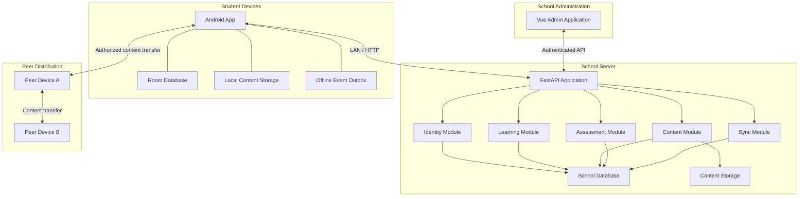

# EDUCONNECT — System Architecture

**Document:** ARCHITECTURE.md  
**Version:** 1.0  
**Status:** Initial architecture baseline  
**Product:** EDUCONNECT  
**Architecture style:** Offline-first, modular, client-server with peer-assisted content distribution  

---

## 1. Project Overview

EDUCONNECT is an offline-first educational ecosystem designed to provide accessible digital learning in schools with limited or unreliable internet connectivity.

It combines:

- A local school server.
- Android applications for students.
- Browser-based teacher and administrator interfaces.
- A learning management system.
- Offline content distribution.
- Device-to-server synchronization.
- Peer-assisted device-to-device content sharing.
- Future local AI capabilities.

The system must remain functional when internet connectivity is completely unavailable.

### 1.1 Core principles

1. **Offline-first:** Internet connectivity must never be required for ordinary local learning.
2. **Local authority:** Each school server is authoritative for its school's users, permissions, assignments and grades.
3. **Local persistence:** Student devices must retain learning activities and downloaded content across application restarts.
4. **Event-driven synchronization:** Offline changes must be queued and delivered reliably.
5. **Modular architecture:** Features must have explicit boundaries and independently testable interfaces.
6. **Selective reuse:** Reuse established open-source libraries and protocols instead of reinventing infrastructure.
7. **Low-resource deployment:** Support inexpensive school hardware.
8. **Security by default:** Authenticate devices and users, validate permissions and protect student information.
9. **AI-friendly development:** Interfaces and responsibilities must be documented and predictable.

---

## 2. System Architecture

EDUCONNECT consists of five major layers.

### 2.1 Student Application

Repository: `educonnect-android`

Technology:
- Kotlin
- Jetpack Compose
- Room / SQLite
- Android WorkManager
- Android Network Service Discovery (NSD)

Responsibilities:
- Student authentication.
- School server discovery and connection.
- Course and lesson browsing.
- Educational content downloads.
- Offline learning.
- Local learning progress tracking.
- Offline quiz attempts.
- Persistent synchronization queue.
- Optional peer content downloads.
- Connectivity and synchronization status.

The Android application must not require a live server connection to access previously downloaded learning resources.

### 2.2 School Server

Repository: `educonnect-server`

Technology:
- Python
- FastAPI
- SQLAlchemy
- SQLite initially
- PostgreSQL as an optional future database backend
- Pydantic

The school server is a modular monolith.

It contains the following modules:

**Identity and Access**
- School identity.
- User accounts.
- Authentication.
- Roles and permissions.
- Device registration.

**Classroom Management**
- Classes.
- Student enrollment.
- Teacher assignments.
- Academic grouping.

**Content Management**
- Content uploads.
- Content metadata.
- Resource organization.
- Content versioning.
- Content integrity verification.

**Learning Management**
- Courses.
- Lessons.
- Learning paths.
- Lesson completion.

**Assessment**
- Quizzes.
- Questions.
- Student attempts.
- Automatic grading.
- Assignment management.

**Learning Records**
- Student activity events.
- Progress summaries.
- Assessment results.
- Learning history.

**Synchronization**
- Event ingestion.
- Idempotency.
- Event acknowledgements.
- Synchronization cursors.
- Conflict handling.

**Administration**
- Server health.
- Storage monitoring.
- Device monitoring.
- Backup and restore.

Modules must communicate through documented internal interfaces. Avoid direct database manipulation across module boundaries.

### 2.3 Teacher and Administrator Application

Repository: `educonnect-admin`

Technology:
- Vue 3
- TypeScript
- Vite

Responsibilities:
- Teacher dashboard.
- Student and classroom management.
- Course creation.
- Content uploads.
- Assessment creation.
- Assignment distribution.
- Student progress monitoring.
- Server administration.

The admin application communicates with the school server through authenticated APIs.

It must work over the local school network without internet connectivity.

### 2.4 Synchronization and Networking

Repository: `educonnect-sync`

Responsibilities:
- Device discovery.
- School server discovery.
- Local network connectivity.
- Synchronization coordination.
- Offline operation delivery.
- Resumable file transfers.
- Peer-assisted content distribution.
- Content integrity verification.
- Retry and recovery.

The initial implementation should use HTTP-based synchronization and transfers.

Advanced peer-to-peer transport can be introduced later without changing the learning data model.

### 2.5 Shared Protocols

Repository: `educonnect-protocol`

Responsibilities:
- OpenAPI specifications.
- JSON schemas.
- Synchronization event definitions.
- API compatibility rules.
- Error response definitions.
- Versioning rules.
- Shared identifiers and enums.

This repository is the authoritative source for cross-repository contracts.

---

## 3. High-Level Architecture

---

## 4. Deployment Architecture

### 4.1 Initial deployment

Target hardware:
- Raspberry Pi 5 with 8 GB RAM, or equivalent mini-PC.
- 256 GB SSD.
- Linux operating system.
- Local Wi-Fi access point.
- Ethernet connection where available.

The school server must provide:
- Backend API.
- Local database.
- Content storage.
- Admin frontend.
- Device discovery endpoint.
- Synchronization services.

Internet access must not be required for these services.

### 4.2 Deployment approach

Use Docker Compose for the initial deployment where practical.

Provide a native installation option for devices where containerization is unsuitable.

Recommended services:
- `educonnect-api`
- `educonnect-admin`
- `educonnect-storage` (logical component, not necessarily a separate process)

Do not introduce Kubernetes or distributed microservices for the initial release.

### 4.3 Capacity targets

Initial design target:
- 50 registered students.
- 50 registered Android devices.
- 20–30 simultaneously active clients as an initial performance target.
- Configurable content storage.
- Recovery after network interruption.
- Simultaneous synchronization after reconnection.

These are engineering targets requiring actual load testing.

---

## 5. Offline-First Architecture

Offline operation is the default operating model.

### Android
The application must:
- Store user session information securely.
- Store downloaded content locally.
- Store learning progress locally.
- Persist pending events.
- Queue operations when disconnected.
- Resume synchronization when connectivity returns.

### School server
The server must:
- Operate without internet.
- Serve locally stored content.
- Authenticate registered devices.
- Accept synchronization events.
- Maintain authoritative learning records.
- Provide local administration.

### Connectivity states
The application must represent:
1. **Offline** — no school server connection.
2. **Connected** — local server reachable.
3. **Synchronizing** — queued operations are being processed.
4. **Sync failed** — operations remain safely queued.
5. **Up to date** — no pending operations.

Never delete unsynchronized data simply because a synchronization request failed.

---

## 6. Data Authority

The school server is authoritative for:
- Student identities.
- Teacher identities.
- Classroom membership.
- User permissions.
- Course publication.
- Official assignment definitions.
- Official grades.
- Device authorization.

Android devices are authoritative for locally generated, unsynchronized user activity until it has been received and validated by the school server.

The server merges accepted learning events into authoritative records.

P2P devices must never become authorities for user permissions or official grades.

---

## 7. Technology Decisions

| Layer                   | Technology               |
| ----------------------- | ------------------------ |
| Android                 | Kotlin + Jetpack Compose |
| Android database        | Room / SQLite            |
| Android background work | WorkManager              |
| Backend                 | Python + FastAPI         |
| Backend validation      | Pydantic                 |
| ORM                     | SQLAlchemy               |
| Initial database        | SQLite                   |
| Future database         | PostgreSQL               |
| Admin frontend          | Vue 3 + TypeScript       |
| API contract            | OpenAPI                  |
| File storage            | Local filesystem         |
| Content integrity       | SHA-256                  |
| Discovery               | Android NSD / mDNS       |
| Initial transfer        | HTTP                     |
| Deployment              | Docker Compose           |
| Version control         | Git + GitHub             |

All dependencies must be pinned and reviewed for license compatibility.

---

## 8. Repository Responsibilities

### educonnect-android
Owns:
- Student interface.
- Local persistence.
- Content viewer.
- Offline activity recording.
- Synchronization client.

Does not own:
- School-wide authoritative records.
- Official grade modification.
- Teacher administration.

### educonnect-server
Owns:
- School-wide data.
- Authentication.
- Learning records.
- Content metadata.
- Assessment definitions.
- Synchronization ingestion.

### educonnect-sync
Owns:
- Synchronization transport.
- Peer discovery.
- File transfer.
- Transfer recovery.

It does not define the meaning of learning records.

### educonnect-protocol
Owns:
- Shared API and event schemas.
- Compatibility rules.
- Protocol versioning.

### educonnect-admin
Owns:
- Teacher and administrator user experience.

### educonnect-infrastructure
Owns:
- Deployment.
- Installation.
- Configuration.
- Backup.
- Monitoring.

---

## 9. Security Architecture

Requirements:
- Secure password hashing.
- Role-based access control.
- Device registration and revocable device credentials.
- Authenticated APIs.
- Authorization on every protected resource.
- TLS for authenticated network communication, including appropriately configured local deployments.
- Content hash verification.
- Secure local credential storage on Android.
- Input validation.
- Rate limiting on authentication endpoints.
- Database backups.
- Student data minimization.

The system must not assume that a local Wi-Fi network is automatically trusted.

---

## 10. AI Integration Readiness

AI functionality is a future capability, not a dependency of the MVP.

Future AI modules may provide:
- Local educational content search.
- Retrieval-augmented generation.
- Offline tutoring.
- Content recommendations.
- Teacher assistance.

AI components must interact through documented APIs.

The core learning application must remain functional when all AI components are unavailable.

---

## 11. Non-Goals for the Initial MVP

Do not implement initially:
- Kubernetes.
- Complex microservices.
- Blockchain.
- Fully decentralized identity.
- Distributed database consensus.
- Cloud-dependent authentication.
- Local LLM inference.
- Advanced analytics.
- Cross-school federation.
- Complex peer-to-peer learning record replication.

---

## 12. Architecture Acceptance Criteria

The architecture is considered implemented when:
1. A school server can be installed without internet access.
2. An Android device can connect to the local server.
3. A student can download content.
4. The student can access downloaded content offline.
5. Learning progress persists locally.
6. Progress synchronizes after reconnection.
7. Duplicate events do not produce duplicate records.
8. The server remains functional without internet access.
9. The system supports the initial 50-device target under tested conditions.
10. The system can be backed up and restored.

---

## 13. Architecture Change Policy

Changes to the following require documentation updates:
- Repository responsibilities.
- Technology stack.
- API contracts.
- Database ownership.
- Data authority.
- Synchronization semantics.
- Security boundaries.

Every architecture change must explain its impact on existing clients and server versions.

**End of document.**
