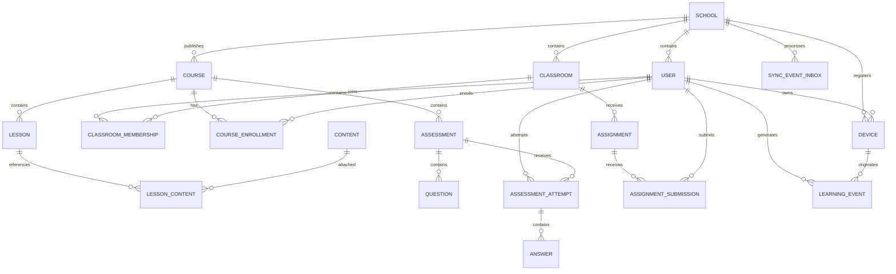

# EDUCONNECT — Data Model

**Document:** DATA_MODEL.md  
**Version:** 1.0  
**Status:** Initial data model baseline  
**Database strategy:** SQLite initially, PostgreSQL-compatible design  
**Mobile database:** Room / SQLite  

---

## 1. Purpose

This document defines the core entities, relationships, identifiers and data ownership rules used throughout EDUCONNECT.

It is the authoritative reference for:
- Backend database models.
- Android Room entities.
- API request and response models.
- Synchronization events.
- Data validation.
- Cross-repository integration.

The data model must support offline operation, incremental synchronization and future multi-school expansion.

---

## 2. Data Modeling Principles

1. Use UUIDs as globally unique identifiers.
2. Use explicit foreign keys.
3. Every school-owned entity must include `school_id` where applicable.
4. Use UTC timestamps in ISO 8601 format for API communication.
5. Store timestamps consistently.
6. Use soft deletion where synchronization requires tombstones.
7. Preserve immutable assessment submissions.
8. Store content binaries separately from relational metadata.
9. Separate server-authoritative data from device-generated activity.
10. Avoid duplicating large content files inside database records.
11. Version externally synchronized records.
12. Never use usernames or filenames as primary keys.

### 2.1 Identifier format

Use UUID identifiers.

Example:
`0194c7b0-1234-7000-8000-000000000001`

UUIDv7 is recommended for newly generated identifiers because it provides time-ordered identifiers.

Clients may generate identifiers while offline.

The server must accept valid client-generated identifiers and enforce uniqueness.

### 2.2 Common fields

School-owned entities generally include:

| Field      | Type                | Description        |
| ---------- | ------------------- | ------------------ |
| id         | UUID                | Primary identifier |
| school_id  | UUID                | Owning school      |
| created_at | Timestamp           | Creation time      |
| updated_at | Timestamp           | Last update        |
| deleted_at | Timestamp, nullable | Soft deletion      |
| version    | Integer             | Record revision    |

Not every table requires every common field. Immutable event records, for example, must not be updated like ordinary mutable records.

---

## 3. Entity Relationship Overview

---

## 4. School and Identity Models

### 4.1 School

Represents an individual school installation.

Table: `schools`

| Field              | Type             | Description          |
| ------------------ | ---------------- | -------------------- |
| id                 | UUID             | School identifier    |
| name               | String           | School name          |
| code               | String           | Unique school code   |
| address            | String, nullable | School address       |
| timezone           | String           | School timezone      |
| preferred_language | String           | Default language     |
| settings_json      | JSON             | School configuration |
| created_at         | Timestamp        | Creation time        |
| updated_at         | Timestamp        | Update time          |

The initial deployment may have one school per server, but the schema must not prevent future multi-school expansion.

### 4.2 User

Table: `users`

| Field              | Type                | Description                 |
| ------------------ | ------------------- | --------------------------- |
| id                 | UUID                | User identifier             |
| school_id          | UUID                | School                      |
| username           | String              | Login username              |
| email              | String, nullable    | Email                       |
| password_hash      | String              | Secure password hash        |
| first_name         | String              | First name                  |
| last_name          | String              | Last name                   |
| role               | Enum                | student, teacher, admin     |
| status             | Enum                | active, inactive, suspended |
| preferred_language | String              | User language               |
| last_login_at      | Timestamp, nullable | Last login                  |
| created_at         | Timestamp           | Creation time               |
| updated_at         | Timestamp           | Update time                 |
| deleted_at         | Timestamp, nullable | Deletion                    |

Constraints:
- Username must be unique within a school.
- Passwords must never be stored in plaintext.
- Email may be optional for offline schools.
- Role changes require appropriate administrative permission.

### 4.3 Device

Table: `devices`

| Field            | Type                | Description                    |
| ---------------- | ------------------- | ------------------------------ |
| id               | UUID                | Device identifier              |
| school_id        | UUID                | School                         |
| user_id          | UUID                | Registered user                |
| device_name      | String              | Display name                   |
| platform         | String              | Android, web, etc.             |
| app_version      | String              | Installed app version          |
| protocol_version | Integer             | Supported protocol             |
| credential_hash  | String              | Device credential verification |
| status           | Enum                | active, revoked, pending       |
| last_seen_at     | Timestamp           | Last connection                |
| registered_at    | Timestamp           | Registration time              |
| revoked_at       | Timestamp, nullable | Revocation time                |

Device credentials must be generated securely and stored using platform security facilities.

Do not store reusable plaintext device secrets in the database.

A device may be shared between students in a future release. The device-user relationship must therefore not be treated as permanently one-to-one.

---

## 5. Classroom Models

### 5.1 Classroom

Table: `classrooms`

| Field         | Type             | Description      |
| ------------- | ---------------- | ---------------- |
| id            | UUID             | Classroom ID     |
| school_id     | UUID             | School           |
| name          | String           | Classroom name   |
| grade_level   | String           | Grade            |
| section       | String, nullable | Section          |
| academic_year | String           | Academic year    |
| status        | Enum             | active, archived |
| created_at    | Timestamp        | Creation         |
| updated_at    | Timestamp        | Update           |

### 5.2 Classroom Membership

Table: `classroom_memberships`

| Field           | Type                | Description      |
| --------------- | ------------------- | ---------------- |
| id              | UUID                | Membership ID    |
| school_id       | UUID                | School           |
| classroom_id    | UUID                | Classroom        |
| user_id         | UUID                | User             |
| membership_role | Enum                | student, teacher |
| joined_at       | Timestamp           | Enrollment time  |
| left_at         | Timestamp, nullable | Departure time   |

A user can belong to multiple classrooms.

Enforce appropriate uniqueness for active memberships.

---

## 6. Course and Learning Models

### 6.1 Course

Table: `courses`

| Field                | Type                | Description                |
| -------------------- | ------------------- | -------------------------- |
| id                   | UUID                | Course ID                  |
| school_id            | UUID                | School                     |
| title                | String              | Course title               |
| description          | Text                | Course description         |
| subject              | String              | Subject                    |
| grade_level          | String              | Grade                      |
| language             | String              | Content language           |
| thumbnail_content_id | UUID, nullable      | Thumbnail                  |
| status               | Enum                | draft, published, archived |
| created_by           | UUID                | Teacher/admin              |
| published_at         | Timestamp, nullable | Publication                |
| created_at           | Timestamp           | Creation                   |
| updated_at           | Timestamp           | Update                     |

### 6.2 Course Enrollment

Table: `course_enrollments`

| Field       | Type      | Description                  |
| ----------- | --------- | ---------------------------- |
| id          | UUID      | Enrollment ID                |
| school_id   | UUID      | School                       |
| course_id   | UUID      | Course                       |
| user_id     | UUID      | Student                      |
| enrolled_at | Timestamp | Enrollment time              |
| status      | Enum      | active, completed, withdrawn |

### 6.3 Lesson

Table: `lessons`

| Field              | Type      | Description                                |
| ------------------ | --------- | ------------------------------------------ |
| id                 | UUID      | Lesson ID                                  |
| school_id          | UUID      | School                                     |
| course_id          | UUID      | Parent course                              |
| title              | String    | Lesson title                               |
| description        | Text      | Lesson description                         |
| lesson_type        | Enum      | video, document, audio, interactive, mixed |
| sequence_number    | Integer   | Lesson order                               |
| estimated_duration | Integer   | Duration in seconds                        |
| status             | Enum      | draft, published, archived                 |
| created_at         | Timestamp | Creation                                   |
| updated_at         | Timestamp | Update                                     |

A lesson can reference multiple content resources.

### 6.4 Lesson Content

Table: `lesson_contents`

| Field           | Type    | Description       |
| --------------- | ------- | ----------------- |
| id              | UUID    | Relationship ID   |
| school_id       | UUID    | School            |
| lesson_id       | UUID    | Lesson            |
| content_id      | UUID    | Content resource  |
| sequence_number | Integer | Display order     |
| is_required     | Boolean | Required resource |

---

## 7. Content Management Models

Content binaries must be stored in the filesystem, not as large database blobs.

### 7.1 Content

Table: `contents`

| Field        | Type             | Description                             |
| ------------ | ---------------- | --------------------------------------- |
| id           | UUID             | Content ID                              |
| school_id    | UUID             | School                                  |
| title        | String           | Resource title                          |
| description  | Text             | Description                             |
| content_type | Enum             | pdf, video, audio, image, html, package |
| mime_type    | String           | MIME type                               |
| language     | String           | Content language                        |
| subject      | String, nullable | Subject                                 |
| grade_level  | String, nullable | Grade                                   |
| status       | Enum             | draft, published, archived              |
| created_by   | UUID             | Uploader                                |
| created_at   | Timestamp        | Creation                                |
| updated_at   | Timestamp        | Update                                  |

### 7.2 Content Version

Table: `content_versions`

| Field           | Type                | Description           |
| --------------- | ------------------- | --------------------- |
| id              | UUID                | Version ID            |
| school_id       | UUID                | School                |
| content_id      | UUID                | Parent resource       |
| version_number  | Integer             | Version               |
| sha256          | String              | Content hash          |
| storage_path    | String              | Relative storage path |
| file_size_bytes | Integer             | Size                  |
| mime_type       | String              | MIME type             |
| created_at      | Timestamp           | Creation              |
| published_at    | Timestamp, nullable | Publication           |

Constraints:
- Every content version is immutable after publication.
- SHA-256 hashes must be verified.
- A content version must never be silently overwritten.
- A new binary requires a new version.
- The same binary may be deduplicated internally using its hash.

### 7.3 Content Metadata

Table: `content_metadata`

| Field          | Type   | Description    |
| -------------- | ------ | -------------- |
| id             | UUID   | Metadata ID    |
| content_id     | UUID   | Content        |
| metadata_key   | String | Metadata key   |
| metadata_value | Text   | Metadata value |

Examples:
- Author.
- Publisher.
- Copyright.
- Source.
- Difficulty level.
- Topic.
- Educational standards.

---

## 8. Learning Progress Models

### 8.1 Learning Event

Table: `learning_events`

This is the authoritative server-side record of accepted learning events.

| Field           | Type      | Description          |
| --------------- | --------- | -------------------- |
| id              | UUID      | Event ID             |
| school_id       | UUID      | School               |
| user_id         | UUID      | Student              |
| device_id       | UUID      | Originating device   |
| event_type      | String    | Event type           |
| entity_type     | String    | Entity type          |
| entity_id       | UUID      | Related entity       |
| device_sequence | Integer   | Device sequence      |
| schema_version  | Integer   | Event schema version |
| payload_json    | JSON      | Event payload        |
| occurred_at     | Timestamp | Device-reported time |
| received_at     | Timestamp | Server receipt       |
| processed_at    | Timestamp | Server processing    |

Learning events are append-only.

Do not edit historical events to represent newer states.

### 8.2 Lesson Progress

Table: `lesson_progress`

| Field                 | Type                | Description                         |
| --------------------- | ------------------- | ----------------------------------- |
| id                    | UUID                | Progress ID                         |
| school_id             | UUID                | School                              |
| user_id               | UUID                | Student                             |
| lesson_id             | UUID                | Lesson                              |
| status                | Enum                | not_started, in_progress, completed |
| completion_percentage | Decimal             | Progress                            |
| last_position_seconds | Integer             | Last playback position              |
| started_at            | Timestamp, nullable | First start                         |
| completed_at          | Timestamp, nullable | Completion                          |
| updated_at            | Timestamp           | Latest projection update            |

Unique constraint:
`(school_id, user_id, lesson_id)`

This table is a derived projection of accepted learning events.

### 8.3 Student Notes

Table: `student_notes`

| Field      | Type                | Description    |
| ---------- | ------------------- | -------------- |
| id         | UUID                | Note ID        |
| school_id  | UUID                | School         |
| user_id    | UUID                | Student        |
| lesson_id  | UUID                | Related lesson |
| content    | Text                | Note           |
| revision   | Integer             | Revision       |
| created_at | Timestamp           | Creation       |
| updated_at | Timestamp           | Update         |
| deleted_at | Timestamp, nullable | Soft deletion  |

Notes must be versioned or otherwise protected against silent overwrites during synchronization.

---

## 9. Assessment Models

### 9.1 Assessment

Table: `assessments`

| Field              | Type              | Description                |
| ------------------ | ----------------- | -------------------------- |
| id                 | UUID              | Assessment ID              |
| school_id          | UUID              | School                     |
| course_id          | UUID              | Course                     |
| title              | String            | Assessment title           |
| description        | Text              | Description                |
| assessment_type    | Enum              | quiz, test                 |
| total_marks        | Decimal           | Total marks                |
| passing_marks      | Decimal, nullable | Passing threshold          |
| time_limit_seconds | Integer, nullable | Time limit                 |
| attempts_allowed   | Integer           | Allowed attempts           |
| status             | Enum              | draft, published, archived |
| created_by         | UUID              | Creator                    |
| created_at         | Timestamp         | Creation                   |
| updated_at         | Timestamp         | Update                     |

### 9.2 Question

Table: `questions`

| Field               | Type           | Description                             |
| ------------------- | -------------- | --------------------------------------- |
| id                  | UUID           | Question ID                             |
| school_id           | UUID           | School                                  |
| assessment_id       | UUID           | Parent assessment                       |
| question_type       | Enum           | mcq, true_false, short_answer           |
| question_text       | Text           | Question                                |
| options_json        | JSON, nullable | Options                                 |
| correct_answer_json | JSON           | Correct answer or grading configuration |
| marks               | Decimal        | Marks                                   |
| sequence_number     | Integer        | Order                                   |
| explanation         | Text, nullable | Explanation                             |

Security requirement:
Correct answers and grading configuration must not be exposed to students before submission unless explicitly intended.

### 9.3 Assessment Attempt

Table: `assessment_attempts`

| Field          | Type                | Description                          |
| -------------- | ------------------- | ------------------------------------ |
| id             | UUID                | Attempt ID                           |
| school_id      | UUID                | School                               |
| assessment_id  | UUID                | Assessment                           |
| user_id        | UUID                | Student                              |
| device_id      | UUID                | Device                               |
| attempt_number | Integer             | Attempt count                        |
| status         | Enum                | in_progress, submitted, graded       |
| started_at     | Timestamp           | Start                                |
| submitted_at   | Timestamp, nullable | Submission                           |
| score          | Decimal, nullable   | Score                                |
| maximum_score  | Decimal             | Maximum                              |
| grading_status | Enum                | pending, automatic, manual, reviewed |

Assessment attempts must be preserved as historical records.

### 9.4 Answer

Table: `answers`

| Field         | Type              | Description        |
| ------------- | ----------------- | ------------------ |
| id            | UUID              | Answer ID          |
| attempt_id    | UUID              | Assessment attempt |
| question_id   | UUID              | Question           |
| answer_json   | JSON              | Student response   |
| awarded_marks | Decimal, nullable | Awarded marks      |
| is_correct    | Boolean, nullable | Correctness        |
| submitted_at  | Timestamp         | Submission         |

Student submissions must be immutable once submitted, except through an explicit administrative correction or review process.

---

## 10. Assignment Models

### 10.1 Assignment

Table: `assignments`

| Field        | Type                | Description              |
| ------------ | ------------------- | ------------------------ |
| id           | UUID                | Assignment ID            |
| school_id    | UUID                | School                   |
| classroom_id | UUID                | Classroom                |
| course_id    | UUID, nullable      | Related course           |
| title        | String              | Assignment title         |
| description  | Text                | Instructions             |
| due_at       | Timestamp, nullable | Deadline                 |
| created_by   | UUID                | Teacher                  |
| status       | Enum                | draft, published, closed |
| created_at   | Timestamp           | Creation                 |
| updated_at   | Timestamp           | Update                   |

### 10.2 Assignment Submission

Table: `assignment_submissions`

| Field            | Type                | Description                       |
| ---------------- | ------------------- | --------------------------------- |
| id               | UUID                | Submission ID                     |
| school_id        | UUID                | School                            |
| assignment_id    | UUID                | Assignment                        |
| user_id          | UUID                | Student                           |
| device_id        | UUID                | Device                            |
| submission_text  | Text, nullable      | Written response                  |
| attachments_json | JSON                | Attachment references             |
| submitted_at     | Timestamp           | Submission                        |
| status           | Enum                | submitted, late, graded, returned |
| marks            | Decimal, nullable   | Grade                             |
| feedback         | Text, nullable      | Teacher feedback                  |
| graded_by        | UUID, nullable      | Teacher                           |
| graded_at        | Timestamp, nullable | Grading time                      |

A student's offline submission must remain locally available until acknowledged by the server.

Grades and teacher feedback are server-authoritative.

---

## 11. Synchronization Database Models

### 11.1 Sync Event Inbox

Table: `sync_event_inbox`

| Field          | Type                | Description                      |
| -------------- | ------------------- | -------------------------------- |
| id             | UUID                | Internal ID                      |
| school_id      | UUID                | School                           |
| event_id       | UUID                | Client event ID                  |
| device_id      | UUID                | Originating device               |
| event_type     | String              | Event type                       |
| schema_version | Integer             | Schema version                   |
| payload_hash   | String              | Payload integrity/reference hash |
| status         | Enum                | accepted, rejected, processed    |
| received_at    | Timestamp           | Receipt                          |
| processed_at   | Timestamp, nullable | Processing                       |

Unique constraint:
`(school_id, event_id)`

This table is essential for idempotency.

### 11.2 Device Sync State

Table: `device_sync_states`

| Field                  | Type                | Description               |
| ---------------------- | ------------------- | ------------------------- |
| id                     | UUID                | Record ID                 |
| school_id              | UUID                | School                    |
| device_id              | UUID                | Device                    |
| last_received_sequence | Integer             | Latest sequence processed |
| last_server_cursor     | String, nullable    | Change cursor             |
| last_sync_at           | Timestamp, nullable | Last synchronization      |
| status                 | Enum                | active, pending, failed   |

The server must not rely exclusively on sequence numbers to identify duplicates. Event IDs remain the idempotency key.

### 11.3 Server Change Log

Table: `server_change_log`

| Field       | Type            | Description               |
| ----------- | --------------- | ------------------------- |
| id          | Integer or UUID | Change identifier         |
| school_id   | UUID            | School                    |
| entity_type | String          | Entity type               |
| entity_id   | UUID            | Entity ID                 |
| change_type | Enum            | created, updated, deleted |
| version     | Integer         | Entity version            |
| created_at  | Timestamp       | Change time               |

This supports incremental synchronization.

Only changes authorized for a particular user or device may be returned.

---

## 12. Content Download Models

### Device Content

Table: `device_contents`

| Field              | Type                | Description                            |
| ------------------ | ------------------- | -------------------------------------- |
| id                 | UUID                | Record ID                              |
| device_id          | UUID                | Device                                 |
| content_id         | UUID                | Content                                |
| content_version_id | UUID                | Downloaded version                     |
| sha256             | String              | Verified hash                          |
| local_path         | String              | Local storage reference                |
| status             | Enum                | downloading, verified, failed, deleted |
| downloaded_at      | Timestamp, nullable | Completion time                        |
| last_accessed_at   | Timestamp, nullable | Last access                            |

### Transfer Session

Table: `transfer_sessions`

| Field              | Type           | Description                              |
| ------------------ | -------------- | ---------------------------------------- |
| id                 | UUID           | Transfer ID                              |
| device_id          | UUID           | Destination device                       |
| content_version_id | UUID           | Requested version                        |
| source_device_id   | UUID, nullable | Peer source                              |
| bytes_transferred  | Integer        | Progress                                 |
| total_bytes        | Integer        | Total size                               |
| status             | Enum           | pending, transferring, completed, failed |
| created_at         | Timestamp      | Creation                                 |
| updated_at         | Timestamp      | Update                                   |

Incomplete transfers must be resumable where supported.

---

## 13. Data Ownership

The following table establishes ownership boundaries.

| Entity                | Authority                                | Offline changes                       |
| --------------------- | ---------------------------------------- | ------------------------------------- |
| School                | Server                                   | Not editable by students              |
| User                  | Server                                   | Limited cached profile                |
| Classroom             | Server                                   | Read-only cache                       |
| Device                | Server registration                      | Device-generated registration request |
| Course                | Server                                   | Read-only cache                       |
| Lesson                | Server                                   | Read-only cache                       |
| Content metadata      | Server                                   | Read-only cache                       |
| Content binaries      | Server/published versions                | Downloaded and cached                 |
| Lesson progress       | Event-based merge                        | Locally editable                      |
| Student notes         | Student/device with versioning           | Locally editable                      |
| Assessment definition | Server                                   | Read-only cache                       |
| Assessment attempt    | Student event history                    | Locally editable until submitted      |
| Assignment            | Server                                   | Read-only cache                       |
| Assignment submission | Student-generated, server accepted       | Locally editable until submitted      |
| Grades                | Server                                   | Read-only cache                       |
| Sync events           | Originating device, then server-accepted | Locally generated                     |

---

## 14. Database Relationships and Constraints

All foreign keys must be enforced.

Important constraints:
1. A classroom must belong to the same school as its memberships.
2. A student enrollment must reference a valid user and course in the same school.
3. A lesson must reference an existing course in the same school.
4. Lesson content must reference valid content.
5. An assessment must belong to a valid course.
6. An answer must belong to an assessment attempt and a question in that assessment.
7. An assignment submission must reference an enrolled student in the target classroom.
8. A device must belong to the same school as its user.
9. Sync events must be associated with valid school and device identities.
10. A device must not access records from another school.

Implement tenant-scoped database queries and authorization checks, not just foreign-key constraints.

---

## 15. Android Local Data Model

The Android application should maintain local copies of the data necessary for offline learning.

Suggested Room database entities:
- `LocalUser`
- `LocalSchool`
- `LocalCourse`
- `LocalLesson`
- `LocalContent`
- `LocalContentVersion`
- `LocalLessonProgress`
- `LocalAssessment`
- `LocalQuestion`
- `LocalAssessmentAttempt`
- `LocalAnswer`
- `LocalAssignment`
- `LocalStudentNote`
- `SyncOutbox`
- `SyncCursor`
- `DeviceContent`

The Android database must not be a direct copy of every server table.

Only store the data necessary for the student's experience and synchronization.

The local database must support migrations.

---

## 16. Indexing Strategy

Create indexes for:
- `users(school_id, username)`
- `classrooms(school_id, status)`
- `classroom_memberships(classroom_id, user_id)`
- `courses(school_id, status)`
- `lessons(course_id, sequence_number)`
- `course_enrollments(user_id, course_id)`
- `contents(school_id, status)`
- `content_versions(content_id, version_number)`
- `lesson_progress(user_id, lesson_id)`
- `assessment_attempts(user_id, assessment_id)`
- `assignment_submissions(assignment_id, user_id)`
- `learning_events(user_id, occurred_at)`
- `sync_event_inbox(school_id, event_id)`
- `device_sync_states(device_id)`

Indexes should be validated using real query patterns.

---

## 17. Data Retention and Backup

Requirements:
- Learning events must have an explicit retention policy.
- Submitted assessments must be preserved.
- Grades must have an audit trail.
- Deleted records must remain available as tombstones until relevant devices have synchronized or a safe retention period has elapsed.
- Content versions may be garbage-collected only when no active course or offline distribution policy requires them.
- Database backups must be consistent.
- Content storage and database backups must be coordinated.
- Restore procedures must be tested.

Do not delete pending synchronization records as part of ordinary cleanup.

---

## 18. Privacy

EDUCONNECT is intended for educational institutions and may process information about children.

Therefore:
- Collect only necessary student information.
- Avoid requiring student email addresses.
- Do not store unnecessary device identifiers.
- Protect local data.
- Restrict teacher access to authorized classrooms.
- Restrict administrators according to school permissions.
- Provide a defined retention and deletion policy.
- Avoid transmitting student information to third-party services by default.

Deployment must comply with applicable data protection and child privacy requirements.

---

## 19. Implementation Order

Implement the data model in this sequence:

### Phase 1 — Foundation
- Schools.
- Users.
- Devices.
- Classrooms.
- Classroom memberships.

### Phase 2 — Content
- Courses.
- Course enrollments.
- Lessons.
- Content.
- Content versions.
- Lesson-content relationships.

### Phase 3 — Offline learning
- Learning events.
- Lesson progress.
- Student notes.
- Sync event inbox.
- Device sync states.

### Phase 4 — Assessments
- Assessments.
- Questions.
- Attempts.
- Answers.

### Phase 5 — Assignments
- Assignments.
- Assignment submissions.

### Phase 6 — Distribution
- Device content.
- Transfer sessions.
- Server change log.

---

## 20. Data Model Acceptance Criteria

1. All entities use globally unique identifiers.
2. School ownership is explicit.
3. Foreign keys are enforced.
4. Offline-created learning events can be stored locally.
5. The server can accept and deduplicate those events.
6. Learning progress can be reconstructed from accepted events.
7. Assessment submissions are preserved.
8. Grades remain server-authoritative.
9. Content binaries are stored separately from relational metadata.
10. Content versions can be verified by SHA-256.
11. Android database migrations are tested.
12. Database backups can be restored successfully.

---

## 21. Change Management

Changes to shared entities or API-facing fields must be coordinated with `educonnect-protocol`.

Database migrations must be version-controlled.

Breaking changes must include:
- Migration scripts.
- Compatibility notes.
- Android impact assessment.
- Server impact assessment.
- Synchronization compatibility assessment.
- Tests.

Never change an existing event's meaning without updating its schema version or introducing a new event type.

**End of document.**
