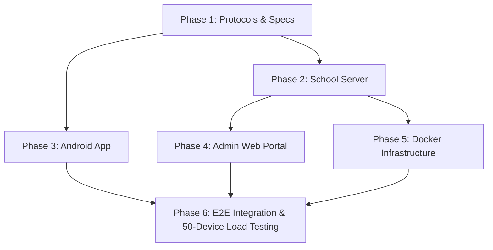

# EDUCONNECT — MVP Implementation Plan

**Document:** MVP_IMPLEMENTATION_PLAN.md  
**Version:** 1.0  
**Status:** Initial actionable plan  
**Target Delivery:** Offline-first MVP (50-student local capacity)  

---

## 1. Plan Overview & Execution Principles

This implementation plan breaks the EDUCONNECT ecosystem into discrete, testable phases. It enforces the system boundaries set forth in `ARCHITECTURE.md`, `SYNC_PROTOCOL.md`, and `DATA_MODEL.md`.

Each task lists:
- Target repository
- Dependencies
- Specific implementation criteria
- Automated test / verification checklist

---

## 2. Phase Breakdown

### Phase 1: Environment & Protocol Foundation
- **Goal:** Establish multi-repo scaffolding, shared protocol definitions, and OpenAPI/JSON schemas.
- **Tasks:**
  1. Initialize directories: `educonnect-docs`, `educonnect-protocol`, `educonnect-server`, `educonnect-android`, `educonnect-sync`, `educonnect-admin`, `educonnect-infrastructure`.
  2. Author `educonnect-protocol` shared event schemas (`schemas/sync_event.json`, `schemas/content_manifest.json`).
  3. Validate schema compatibility between Python (Pydantic) and Kotlin (Kotlinx.serialization / Gson).

### Phase 2: School Server Foundation (`educonnect-server`)
- **Goal:** Build the modular monolith backend in Python + FastAPI with SQLite.
- **Tasks:**
  1. **Core Setup:** FastAPI application setup, SQLite database engine, SQLAlchemy async or synchronous session management, Alembic migrations.
  2. **Identity & Auth Module:** User authentication, password hashing (Argon2 or bcrypt), JWT issuance, Role-Based Access Control (`student`, `teacher`, `admin`), device registration.
  3. **Classroom & Learning Module:** CRUD for schools, classrooms, memberships, courses, lessons, and lesson content mappings.
  4. **Content Management Module:** Metadata storage, filesystem content binary storage, SHA-256 computation, resumable chunked downloads (`Range` request support).
  5. **Sync Engine Module:**
     - `POST /api/v1/sync/v1/events` endpoint.
     - Event inbox table with `(school_id, event_id)` uniqueness.
     - Transactional idempotency processing.
     - Monotonic progress projection into `lesson_progress`.
     - Sync status and incremental change feed endpoints.
  6. **Unit & Integration Tests:** Pytest test suite testing auth, idempotent ingestion, duplicate rejection, and content hashing.

### Phase 3: Android Student Application (`educonnect-android`)
- **Goal:** Develop offline-first Kotlin + Jetpack Compose student application.
- **Tasks:**
  1. **App Architecture:** MVI/MVVM with Jetpack Compose, Kotlin Coroutines, Navigation Component.
  2. **Room Database:** Local entities matching `LocalUser`, `LocalCourse`, `LocalLesson`, `LocalLessonProgress`, `SyncOutbox`.
  3. **Outbox & Sync Worker:**
     - Local SQLite transaction writing learning progress and appending to `sync_outbox`.
     - Android `WorkManager` background periodic/opportunistic sync task.
     - Exponential backoff with jitter on network failure.
  4. **Content Downloader:**
     - Download manager with HTTP Range resume support.
     - SHA-256 local hash calculation before marking content as verified and playable.
  5. **UI & Theme:**
     - Purple, white, and black visual identity.
     - Offline status indicators (Offline, Connected, Synchronizing, Sync Failed, Up to date).

### Phase 4: Teacher & Admin Dashboard (`educonnect-admin`)
- **Goal:** Develop local web administration portal in Vue 3 + TypeScript + Vite.
- **Tasks:**
  1. **Vite Setup:** Vue 3 Composition API, Pinia state management, Tailwind CSS configured with the purple/black/white theme.
  2. **Classroom & Student Management:** Enrolling students, assigning credentials.
  3. **Course & Content Authoring:** Uploading PDFs, videos, organizing lessons, previewing content integrity.
  4. **Assessment Builder:** Creating MCQ and short-answer quizzes.
  5. **Sync & Device Monitor:** Real-time visibility into registered devices, last seen timestamps, and sync queue backlog.

### Phase 5: Local Infrastructure & Packaging (`educonnect-infrastructure`)
- **Goal:** Enable zero-internet single-command deployment on Raspberry Pi 5 or mini-PC.
- **Tasks:**
  1. `docker-compose.yml` defining `educonnect-api`, `educonnect-admin`, and persistent volume bindings.
  2. Automated initialization script (`init-school.sh` / `setup.py`) that initializes the SQLite database and seeds default administrative credentials.
  3. mDNS / NSD service broadcast configuration so Android devices discover the school server without manual IP entry.

### Phase 6: End-to-End Verification & Capacity Testing
- **Goal:** Validate all 10 architecture acceptance criteria and 10 sync acceptance criteria.
- **Tasks:**
  1. Simulate 50 concurrent Android client sync batches against Raspberry Pi hardware profile.
  2. Test network disruption mid-sync and verify zero data loss and resumable progress.
  3. Test double-submission of assessment attempts and verify strict idempotency.

---

## 3. Dependency Graph

---

## 4. Acceptance Criteria Checklist

- [ ] School server installs and boots with zero active internet connection.
- [ ] Android device discovers school server automatically via mDNS/NSD or local IP.
- [ ] Student downloads course materials; files verify correctly against server SHA-256 hash.
- [ ] Student completes lessons in full airplane mode; events persist in Room `sync_outbox`.
- [ ] On reconnecting, `WorkManager` delivers events to `/sync/v1/events`; server acknowledges without data loss.
- [ ] Submitting the same batch twice returns original acknowledgements without double-processing.
- [ ] Interrupted downloads resume from previous byte offset.
- [ ] Admin dashboard renders student progress and server health over local Wi-Fi.

**End of document.**
