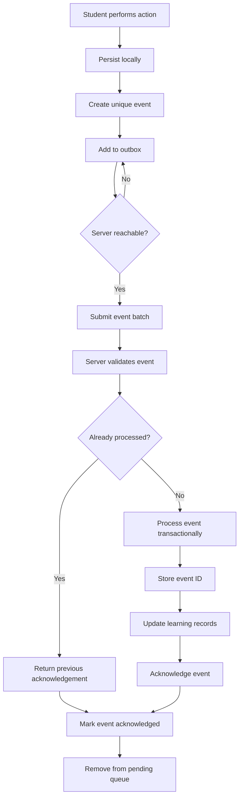

# EDUCONNECT — Synchronization Protocol

**Document:** SYNC_PROTOCOL.md  
**Version:** 1.0  
**Status:** Initial protocol specification  
**Protocol family:** EDUCONNECT Sync Protocol (ESP)  

---

## 1. Purpose

EDUCONNECT must support learning when student devices and the school server are intermittently connected or completely disconnected.

The synchronization protocol defines how:
- Android devices store offline operations.
- Devices submit pending learning events.
- The school server validates and processes events.
- The server acknowledges successful operations.
- Clients recover from failed transfers.
- Content is distributed between devices.
- Conflicting changes are handled.

The protocol prioritizes data durability, idempotency and predictable recovery.

---

## 2. Core Synchronization Principles

1. Offline operations must be persisted before being acknowledged to the user as saved.
2. Every event must have a globally unique event ID.
3. Repeated delivery must not create duplicate records.
4. The server validates permissions and event ownership.
5. The client retains events until the server acknowledges them.
6. Synchronization must be incremental.
7. Content synchronization and learning-record synchronization are separate operations.
8. Conflicts must be resolved according to data type.
9. Server and device clocks must not be assumed to be perfectly synchronized.
10. A failed synchronization must never silently destroy local data.

---

## 3. Synchronization Architecture

The system uses an event-driven synchronization model.

### Android components
- Local event store.
- Persistent outbox.
- Synchronization worker.
- Server connection manager.
- Event acknowledgement processor.
- Content download manager.

### Server components
- Event ingestion endpoint.
- Event validation.
- Idempotency store.
- Event processor.
- Learning-record projection.
- Acknowledgement generator.
- Synchronization cursor manager.

### Event lifecycle



---

## 4. Event Structure

All synchronization events must follow a common envelope.

### 4.1 Standard event schema

```json
{
  "event_id": "0194c7b0-1234-7000-8000-000000000001",
  "event_type": "lesson.completed",
  "schema_version": 1,
  "school_id": "school-001",
  "user_id": "student-001",
  "device_id": "device-001",
  "entity_type": "lesson",
  "entity_id": "lesson-001",
  "device_sequence": 105,
  "occurred_at": "2026-11-19T12:30:00Z",
  "recorded_at": "2026-11-19T12:30:01Z",
  "payload": {
    "course_id": "course-001",
    "completion_percentage": 100
  }
}
```

### 4.2 Field definitions

| Field           | Purpose                                    |
| --------------- | ------------------------------------------ |
| event_id        | Globally unique event identifier           |
| event_type      | Type of operation                          |
| schema_version  | Event schema version                       |
| school_id       | Owning school                              |
| user_id         | User associated with the operation         |
| device_id       | Originating device                         |
| entity_type     | Affected entity type                       |
| entity_id       | Affected entity identifier                 |
| device_sequence | Monotonic sequence allocated by the device |
| occurred_at     | Device-reported action time                |
| recorded_at     | Device event creation time                 |
| payload         | Event-specific data                        |

Timestamps are informational, not sufficient for ordering conflicting events.

The server must record its own receipt and processing timestamps.

---

## 5. Initial Event Types

### Learning events
- `lesson.started`
- `lesson.progress_updated`
- `lesson.completed`
- `content.bookmarked`
- `note.created`
- `note.updated`

### Assessment events
- `assessment.started`
- `assessment.answer_saved`
- `assessment.submitted`

### Assignment events
- `assignment.received`
- `assignment.submitted`

### Device events
- `device.registered`
- `device.last_seen`

### Content events
- `content.downloaded`
- `content.verified`

Events must be versioned. Removing or changing the meaning of an existing event requires a new schema version or a new event type.

---

## 6. Local Event Storage

The Android application must maintain a persistent outbox.

Suggested table:

```sql
CREATE TABLE sync_outbox (
    event_id TEXT PRIMARY KEY,
    event_type TEXT NOT NULL,
    schema_version INTEGER NOT NULL,
    payload_json TEXT NOT NULL,
    device_sequence INTEGER NOT NULL,
    created_at TEXT NOT NULL,
    status TEXT NOT NULL DEFAULT 'pending',
    retry_count INTEGER NOT NULL DEFAULT 0,
    last_attempt_at TEXT,
    acknowledged_at TEXT
);
```

Allowed states:
- `pending`
- `in_flight`
- `acknowledged`
- `rejected`
- `requires_review`

An event must not be deleted while pending or in flight.

Rejected events must remain available for diagnostics or recovery until an explicit retention policy allows removal.

Local event creation and local progress updates should occur in the same database transaction.

---

## 7. Synchronization API

All endpoints are school-server-local APIs.

### 7.1 Device registration

`POST /api/v1/devices/register`

Registers an authorized device.

### 7.2 Synchronization upload

`POST /api/v1/sync/v1/events`

Uploads a batch of pending events.

Example request:

```json
{
  "protocol_version": 1,
  "device_id": "device-001",
  "batch_id": "batch-001",
  "events": [
    {
      "event_id": "event-001",
      "event_type": "lesson.completed",
      "schema_version": 1,
      "school_id": "school-001",
      "user_id": "student-001",
      "device_id": "device-001",
      "entity_type": "lesson",
      "entity_id": "lesson-001",
      "device_sequence": 105,
      "occurred_at": "2026-11-19T12:30:00Z",
      "recorded_at": "2026-11-19T12:30:01Z",
      "payload": {
        "course_id": "course-001",
        "completion_percentage": 100
      }
    }
  ]
}
```

### 7.3 Synchronization response

```json
{
  "batch_id": "batch-001",
  "protocol_version": 1,
  "acknowledged": [
    "event-001"
  ],
  "duplicates": [],
  "rejected": [],
  "requires_review": [],
  "server_cursor": "cursor-001"
}
```

The server must only acknowledge an event after successful durable processing or durable acceptance into a server-side processing queue.

For the initial implementation, synchronous transactional processing is preferred.

### 7.4 Download server updates

`GET /api/v1/sync/v1/changes?cursor=cursor-001`

Returns incremental changes the device is authorized to receive.

### 7.5 Synchronization status

`GET /api/v1/sync/v1/status`

Returns:
- Server protocol version.
- Device synchronization status.
- Pending operation count.
- Last successful synchronization.
- Server cursor.

---

## 8. Idempotency and Duplicate Prevention

Every event ID is unique.

The server maintains an event inbox with a unique constraint on:

`(school_id, event_id)`

When the same event arrives again:
1. Check whether the event ID has already been processed.
2. If processed, return the original acknowledgement.
3. Do not repeat its business operation.
4. If not processed, validate and process it.
5. Store the event ID and resulting state in the same database transaction.

Batch IDs are useful for diagnostics but are not substitutes for event-level idempotency.

---

## 9. Conflict Resolution

Different data types require different conflict policies.

| Data type              | Conflict strategy                                              |
| ---------------------- | -------------------------------------------------------------- |
| Lesson completion      | Monotonic merge                                                |
| Lesson progress        | Maximum valid progress, with latest position stored separately |
| Quiz submission        | Immutable submission records                                   |
| Quiz answers           | Preserve attempts and revisions                                |
| Student notes          | Versioned records; preserve conflicting revisions              |
| Bookmarks              | Last accepted update or explicit merge                         |
| Assignment definitions | Server-authoritative                                           |
| Assignment grades      | Server-authoritative                                           |
| User permissions       | Server-authoritative                                           |
| Course content         | Version-based replacement                                      |

### Important rules
- Never use device timestamps alone to decide which grade is correct.
- Do not silently overwrite student notes.
- Preserve immutable assessment submissions.
- A device cannot modify server-owned assignment definitions.
- Conflict resolution must be deterministic and testable.

---

## 10. Content Synchronization

Content synchronization is separate from event synchronization.

Each content resource has:
- Content ID.
- Version ID.
- SHA-256 hash.
- MIME type.
- Size.
- Metadata.
- Publication status.

Example manifest:

```json
{
  "content_id": "content-001",
  "version_id": "version-003",
  "filename": "mathematics-chapter-1.pdf",
  "mime_type": "application/pdf",
  "size_bytes": 5242880,
  "sha256": "replace-with-real-sha256",
  "download_path": "/api/v1/content/content-001/download"
}
```

### Content download flow
1. Device requests the content manifest.
2. Device compares local content versions.
3. Device requests missing content.
4. Download begins.
5. Interrupted transfers can resume using HTTP Range requests where supported.
6. Device verifies the complete SHA-256 hash.
7. Content is atomically marked available.
8. The device updates its local manifest.

Never mark partially downloaded content as available.

### Content storage rules
- Use immutable content versions.
- Avoid overwriting content files in place.
- Use content hashes to detect corruption and duplicates.
- Maintain metadata separately from binary files.

---

## 11. Peer-to-Peer Content Distribution

P2P is an optional content-delivery optimization.

The initial P2P implementation must not distribute authoritative learning records.

### Peer download flow
1. Student requests content.
2. Android checks the school server manifest.
3. Android discovers authorized peers.
4. Android checks which peers have the required content version.
5. Android obtains a valid authorization or content-sharing token.
6. Android downloads content from a peer.
7. Android verifies the content hash.
8. Android marks the resource available locally.

The school server remains the authority for content metadata and access permissions.

Peers must not be trusted to provide unverified content.

---

## 12. Retry and Recovery

Synchronization must use exponential backoff with jitter.

Suggested initial delays:
- First retry: 5 seconds.
- Second retry: 15 seconds.
- Third retry: 30 seconds.
- Fourth retry: 60 seconds.
- Later retries: progressively increase up to 15 minutes.

Reset the retry count after successful acknowledgement.

Additional requirements:
- Persist retry state.
- Respect Android battery and network constraints.
- Retry transient failures.
- Do not endlessly retry permanent validation failures.
- Allow manual synchronization.
- Resume interrupted downloads.

---

## 13. Event Ordering

Events from a single device use monotonically increasing sequence numbers.

However:
- Device clocks may be incorrect.
- Different devices have no guaranteed common event order.
- Sequence numbers may have gaps after failed or cancelled transactions.

The server must not assume that timestamps alone establish event ordering.

Where one operation depends on another, include an explicit reference or dependency identifier.

---

## 14. Authentication and Authorization

All synchronization requests must be authenticated.

The server must validate:
- Device registration.
- Device authorization status.
- User identity.
- School membership.
- Event ownership.
- Event type permissions.
- Payload size and schema.

A device must not submit events on behalf of another student without explicit authorization.

Revoked devices must be denied future synchronization.

The protocol must never trust an event merely because it originated from the school Wi-Fi network.

---

## 15. Version Compatibility

The protocol uses explicit versioning.

Initial API version:
`/api/v1/`

Initial event schema version:
`1`

Every client reports its supported protocol version.

The server must:
- Accept supported older clients where feasible.
- Reject unsupported incompatible versions clearly.
- Avoid silently interpreting unknown event types.
- Preserve backward compatibility where possible.

Schema changes must be tested against Android and server implementations.

---

## 16. Initial Implementation Scope

### MVP requirements
- Persistent Android event outbox.
- Event IDs.
- Device sequence numbers.
- Event upload endpoint.
- Server event inbox.
- Idempotent processing.
- Event acknowledgements.
- Basic learning-progress synchronization.
- Retry and recovery.
- Content manifest.
- Verified content downloads.

### Post-MVP requirements
- Incremental change feeds.
- Advanced conflict resolution.
- Peer-assisted content delivery.
- More sophisticated synchronization scheduling.
- Multi-school federation.
- Advanced replication.

---

## 17. Synchronization Acceptance Tests

1. An offline lesson completion remains stored after an application restart.
2. Reconnecting uploads the pending event.
3. Uploading the same event twice creates only one business record.
4. A failed request does not delete the local event.
5. A server restart does not lose acknowledged events.
6. Interrupted content downloads resume.
7. Corrupted content fails hash verification.
8. Revoked devices cannot upload events.
9. An old device cannot overwrite official grades.
10. Multiple pending events synchronize correctly after a long offline period.

**End of document.**
